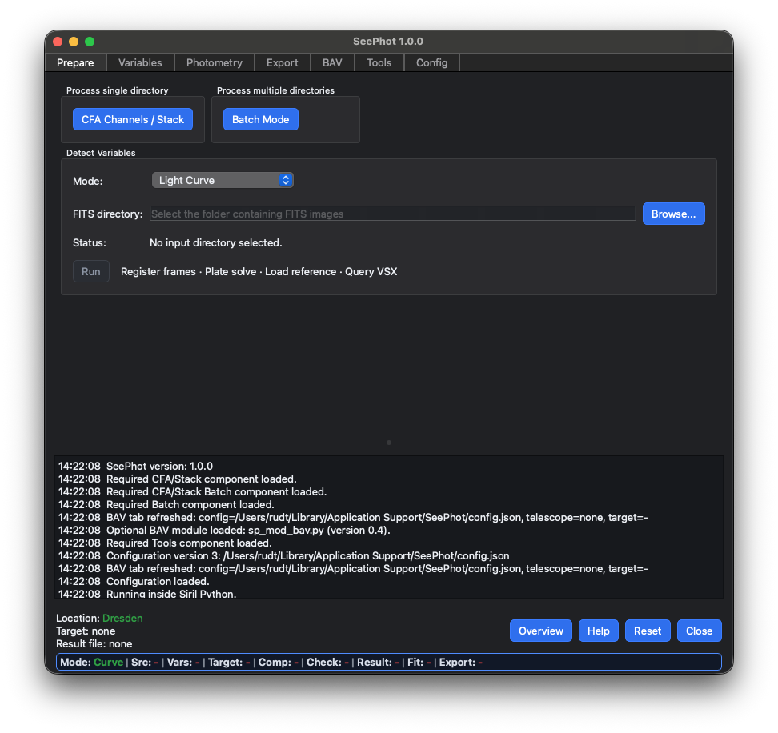
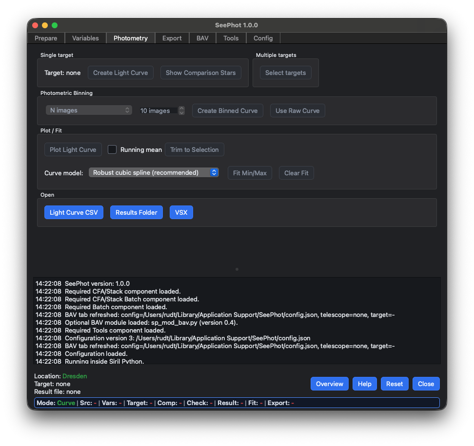
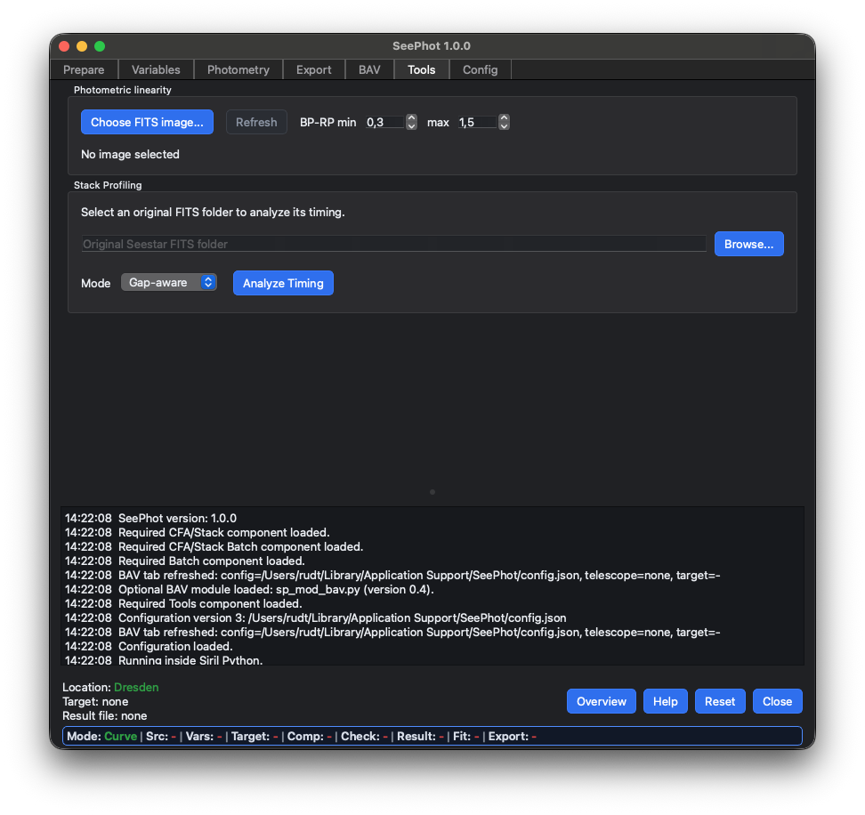
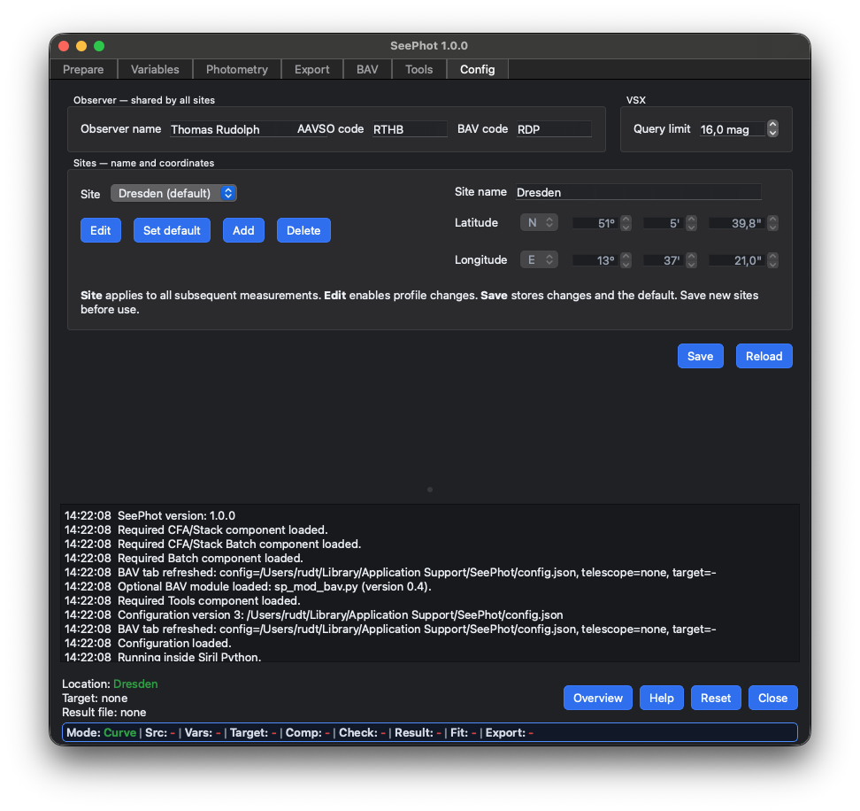

# SeePhot

SeePhot is a Siril Python application for variable-star photometry with FITS
images, primarily designed for Seestar data. Other FITS images can be used
when their format, filter information, and headers are suitable for plate
solving and accurate photometric timing.

It combines image preparation, automatic comparison-star selection,
calibrated measurements, light-curve analysis, and AAVSO/BAV reporting.

Two measurement workflows are available: **Light Curve** measures a time
series, while **Single Measurement** measures targets in an individual image.

The included **SeePhot CFA** companion extracts CFA channels and stacks
images. It can be opened from SeePhot or used independently in Siril.

## Screenshots

<h3 align="center">Prepare</h3>

<h3 align="center">Photometry</h3>

<h3 align="center">Tools</h3>

<h3 align="center">Config</h3>

## Current Release

- SeePhot Main: `1.0.1`
- SeePhot CFA: `1.0.0`

## Release Bundle

Keep all twelve Python files and both Overview images together in the same
Siril script directory:

- `SeePhot_Main.py` — main photometry and analysis application.
- `SeePhot_CFA.py` — CFA channel extraction and stacking companion.
- `sp_mod_airmass.py` — airmass calculation for photometry and reporting.
- `sp_mod_analyze.py` — light-curve analysis tools.
- `sp_mod_auto.py` — multi-folder CFA/stack batch workflow.
- `sp_mod_batch.py` — multi-target photometry batch workflow.
- `sp_mod_bav.py` — BAV report and export support.
- `sp_mod_binning.py` — scientific flux-based light-curve binning.
- `sp_mod_config.py` — observer, site, and application settings.
- `sp_mod_linearity.py` — linearity and dynamic-range diagnostics.
- `sp_mod_profiling.py` — stack timing analysis and recommendations.
- `sp_mod_results.py` — result and output-file management.
- `seephot_workflow.png` — General workflow image.
- `seephot_files_and_folders.png` — Files and folders image.

## Main Features

- **Light Curve** photometry for image series and **Single Measurement**
  for individual images.
- Variable-star discovery with a configurable VSX magnitude limit,
  automatic comparison-star selection, and calibrated measurements.
- Light-curve plotting, scientific flux-based binning, and extremum fitting.
- Gaia-based assessment of target contamination and background-annulus
  quality, with diagnostic results.
- AAVSO photometry reports and BAV extrema reports, including multiple
  extrema and optional period information.
- Multi-target photometry batches and multi-folder CFA/stack batches.
- Additional Single Measurement targets from SIMBAD, Gaia DR3, or entered
  coordinates, with clearly marked informational results when needed.
- CFA channel extraction, including single-frame processing without stacking.
- Continuous and Gap-aware stacking, with stack profiling and grouping
  recommendations.
- Shared observer and site settings.
- Photometric linearity and dynamic-range analysis.

## Requirements

- Siril 1.3.0 or newer with Python scripting support.
- `sirilpy` 1.0.13 or newer.
- Python packages: `PyQt6`, `astropy`, `numpy`, `scipy`, `matplotlib`,
  and `pyvo`.
- Some catalog queries additionally use `astroquery`; BAV PDF reports
  require `reportlab`.
- SeePhot automatically requests installation of missing core packages
  through Siril.

Run SeePhot inside Siril's Python environment.

## Installation

> [!IMPORTANT]
> **You should definitely install the local Gaia DR3 catalog required for plate solving.**
> Siril normally retrieves this star catalog from the **VizieR online database**. These queries currently time out, blocking plate solving and the SeePhot workflow.
>
> In Siril: **Scripts → Python Scripts → Core → Siril_Catalog_Installer.py → Astrometry Catalog → Install**. The installer configures Siril automatically.

1. Download **Source code (zip)** from the **Latest** release on the
   [SeePhot releases page](https://github.com/Aquarius58/SeePhot/releases)
   and extract the archive.
2. Create a separate folder on your drive for the SeePhot scripts,
   for example `SeePhot`.
3. Copy all `.py` files and both `.png` images from the archive into
   that folder.
4. In Siril's settings, add this folder as an additional Python script
   directory.
5. The folder name you chose, for example **SeePhot**, then appears
   automatically in Siril's **Python Scripts** menu. Open it and start
   `SeePhot_Main.py`.

`SeePhot_Main.py` and `SeePhot_CFA.py` are the executable applications.
Files beginning with `sp_mod_` are support modules and should not be
started directly.

## Standalone CFA Usage

To use CFA channel extraction and stacking independently, follow the
installation steps above and start `SeePhot_CFA.py` instead of
`SeePhot_Main.py`.

For a minimal installation, only `SeePhot_CFA.py` is needed. It requires
Siril with Python scripting support, `sirilpy`, `PyQt6`, `astropy`, and
`numpy`.

The [Seestar CFA project page](https://github.com/Aquarius58/siril-seestar-stack)
provides technical documentation, screenshots, and
[support](https://github.com/Aquarius58/siril-seestar-stack/issues).

## License

SeePhot and the included support modules are licensed under
GPL-3.0-or-later. See `LICENSE` and the SPDX identifier in each source file.
